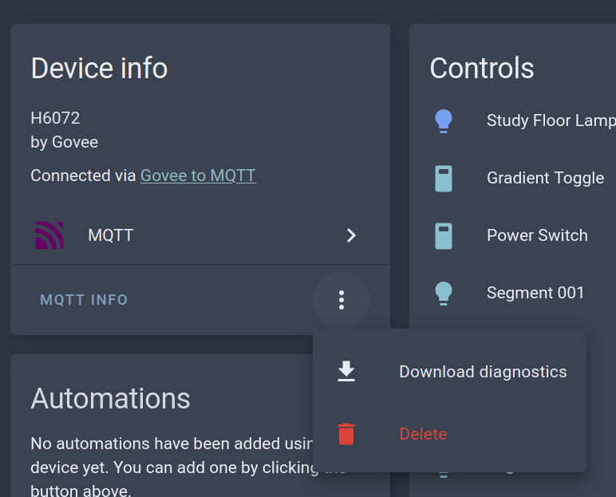

# Frequently asked Questions

## Why can't I turn off a Segment?

The Govee API for segments can only specify brightness and color, rather than
power state for the segment.

However, Home Assistant's Light entity assumes that there is a power state
control for all lights, so when the entity is made available to Home Assistant
it shows up with a power control.

Consequently, the power control for a segment does nothing and cannot be
removed from the Home Assistant UI for the light entity.

## Why is my control over a Segment limited?

Govee to MQTT merely passes your control requests on to the Govee device,
and what happens next depends upon Govee. Some devices are more flexible
than others.  For example, some devices cannot set a segment brightness to 0,
while others have their individual brightness bound to the brightness of
the overall light entity.

Govee to MQTT has no way to control this device-specific behavior.

## How do I enable Video Effects for a Light?

The Govee API doesn't support returning video effects, so they are not made
available in the list of effects for a light.

What you can do to make video effects available in Home Assistant is to use the
Govee Home App to create either a "Tap-to-Run" shortcut or a saved "Snapshot"
that activates the desired mode for the device.

Then, go to the "Govee to MQTT" device in the MQTT integration in Home
Assistant and click the "Purge Caches" button.

* Tap-to-Run will be mapped into Home Assistant as a Scene entity.
* Snapshots will appear in the list of Effects on the device itself.

## My Device(s) appear as Greyed Out and Unavailable in Home Assistant

This suggests that there is a problem with (re)registering the entity
in Home Assistant.

There may be more information available in the Home Assistant logs.  Look for
log entries that reference `gv2mqtt` or `mqtt`.  Please make a point of
collecting that and [reporting an issue](https://github.com/IamTheLoki/govee2mqtt/issues).

You may also wish to try deleting the device(s) from the MQTT integration
in Home Assistant, then going to the "Govee to MQTT" device and clicking
the "Purge Caches" button to see how the situation evolves.

## Is my device supported?

Check out [this page](SKUS.md) for more details on supported devices.

## Please add support for HXXXX

As is explained in [this page](SKUS.md), there is little direct knowledge of
specific devices in this software, which acts as a bridge into Govee's
documented and undocumented APIs. There isn't anything practical that can be
done here to directly control a device that isn't supported by Govee's APIs.

## The device MAC addresses shown in the logs don't match the MACs on my network!?

Govee device IDs are not network MAC addresses. For some devices the device ID
is a superset of the BLE MAC for the device, but if you look carefully you'll
see that the device ID is too large to be a MAC.

## This device should be available via the LAN API, but didn't respond to probing yet

Look at [this page](LAN.md) for more details on the LAN API and things you can try.

## "devices not belong you" error in logs

This error appears to be returned from Govee when trying to use the Platform
API with devices that are BLE-only and have no WiFi support.  Please [file an
issue](https://github.com/IamTheLoki/govee2mqtt/issues) about this so that we can add an entry to the quirks database.

## My H5192 meat thermometer shows no values or `unknown`

The H5192 does not push its readings, it only answers requests that the bridge
sends over the AWS IoT channel. For that you need to configure `GOVEE_EMAIL`
and `GOVEE_PASSWORD`.

* Without `Live Polling` the thermometer is read every 15 minutes, so the
  values can be up to 15 minutes old after a restart. Switch on the
  `Live Polling` entity of the device while you cook.
* A probe that is not plugged in, and an alarm limit that is not set, show up
  as `unknown`.
* The alarm limits are read-only; set them in the Govee app. Changes show up
  within a minute while `Live Polling` is on.
* For troubleshooting set `RUST_LOG=govee=debug`: the log then contains the
  lines `Probe frame ...` for every answer of the device.

Details about the entities are in the [README](../README.md#h5192).
